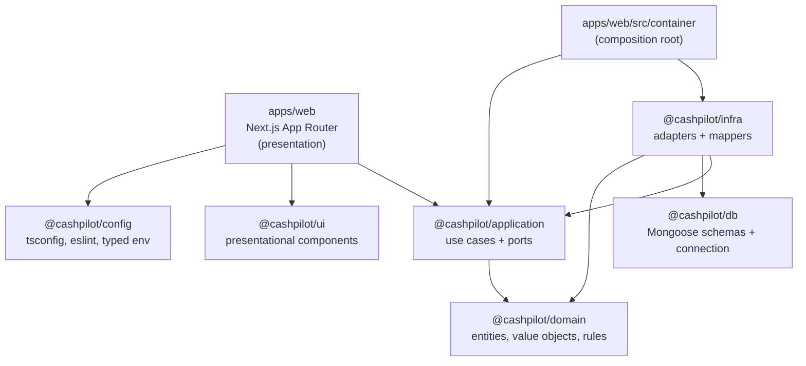

# CashPilot — Architecture and design choices

This document justifies how CashPilot is built (course deliverable, slide 57). The course itself is kept in `docs/reference/COURSE-ARCHITECTURE.md`; the functional spec is `docs/PROJECT.md`.

## 1. Layers and packages

| Package | Contains | May import |
|---|---|---|
| `domain` | Entities (`Invoice`, `Expense`, `CashMovement`, `Scenario`…), value objects (`Money`, `DateOnly`, ids), domain errors with stable codes, pure services (`ForecastEngine`, `ScenarioEngine`, `AlertEvaluator`, `CashBalanceCalculator`), the role → permission policy | nothing |
| `application` | One class per use case (`execute(input)`), ports (repositories, `FinancialLedger`, `Clock`, `IdGenerator`, `PdfExporter`, `FileStorage`, `Logger`), `authorize()` | domain |
| `infra` | MongoDB repositories, mappers, the transactional ledger, PDF (pdf-lib), Cloudinary storage, JSON logger, in-memory adapters for tests | application, domain, db |
| `db` | Mongoose schemas, declared document types, the cached connection | mongoose |
| `ui` | Server-safe presentational components (`PageHeader`, `Card`, `Stat`, `StatusChip`, `EmptyState`) | react |
| `apps/web` | Routes, Server Components, Server Actions with Zod, route handler for the PDF, client form leaves | application, ui, config (+ infra in `container/` only) |

**The dependency rule is a test**: `pnpm depcruise` fails the build if, for example, the domain imports mongoose, a page imports `@cashpilot/domain` or `@cashpilot/db`, or anything but the composition root imports `@cashpilot/infra` (`.dependency-cruiser.cjs`, run in CI).

## 2. One request, end to end (record a payment)

1. `invoices/[id]/page.tsx` (Server Component) renders the form with a hidden `operationId` (a fresh UUID).
2. `ActionForm` (the only client part) posts to `recordPaymentAction` (`'use server'`).
3. The action reads the actor from the session (`lib/session.ts`) — the company id comes from a cookie but is accepted only if the user is a member.
4. Zod checks the **shape** (amount typed in DNT → integer millimes, date format, method).
5. `RecordPayment.execute` checks the **permission** (`payments.record`), loads the invoice, asks the **entity** to apply the payment (`PAYMENT_EXCEEDS_REMAINING`, `INVOICE_NOT_PAYABLE`…), builds the `Payment` and one `CashMovement`.
6. `FinancialLedger.recordInvoicePayment` (Mongo adapter) writes invoice + payment + movement in **one transaction**, only if the stored remaining amount is still the one that was read; a repeated `operationId` is a duplicate key → `DUPLICATE_OPERATION`.
7. An audit entry is appended; the action calls `revalidatePath` and returns a message, or the domain error code translated to English (`lib/error-messages.ts`).

## 3. Key decisions

| Decision | Why |
|---|---|
| **MongoDB Atlas + Mongoose instead of PostgreSQL + Prisma** (team decision) | Free hosted tier. The course's "replacement test" still holds: Mongo appears only in `packages/db` and `packages/infra`; use cases and pages do not know it. |
| **Money = integer millimes** in a `Money` value object; signed | No rounding errors (spec criterion). Signed because a forecast can go below zero. Input is parsed from text without floats (`lib/money-input.ts`). |
| **Dates = `DateOnly` (`YYYY-MM-DD`)**, time only through the `Clock` port | Due dates are calendar dates; tests can freeze time. |
| **Real balance = sum of cash movements**; the opening balance is the first movement | One source of truth, so an operation counts exactly once (criterion 4). Corrections are new `adjustment` movements with a reason — nothing is edited or deleted. |
| **`FinancialLedger` port** for every write that moves money | Payment + invoice + movement must be atomic; the transaction stays inside the adapter, not in use cases. Append-only and idempotent. |
| **Permissions in one domain map** (`domain/src/access/permissions.ts`), checked by `authorize()` in every use case | Defense in depth: middleware only checks that a session exists; the UI hides buttons for comfort; the use case is the real check. Adding a role = editing the map. |
| **Forecast rules live in the entities** (`Invoice.expectedReceipt()`, `Expense.plannedDisbursement()`) and in `buildForecastInputs` | The rule exists once; forecast, dashboard, alerts and simulation all use it. |
| **Simulation = pure function** `ScenarioEngine.apply(inputs, hypotheses)` returning new inputs; `RunSimulation` has no write port | A simulation cannot modify real data by construction (criterion 6). |
| **No implicit membership**: signing in creates the user, never a membership | A stranger with a Google account sees nothing; they create their own company (onboarding) or are added by an owner. |
| **Mappers between documents and entities** | Stored shape and business model evolve separately; Mongoose types never leave `infra`. The in-memory adapters store the same documents, so tests behave like a database. |
| **No seed, no in-memory fallback in the running app** | Every screen shows real data from MongoDB. In-memory adapters exist only for tests. |
| **Server Components by default, `'use client'` only on form leaves, nav and animations** | Less JavaScript; data is read on the server through use cases. |

## 4. Testing strategy

| Layer | Tool | What |
|---|---|---|
| Domain | Vitest, no mocks | Every rule and state transition, the worked forecast examples A and B from `UNDERSTANDING.md` §5 (shortage 15 → 29 Nov at −1 000 DT). |
| Application | Vitest + fakes (`test/world.ts` wires every use case like the container) | Spec validation criteria 1–9, permissions per role, audit trail, the full defense scenario. |
| Infrastructure | Vitest + `mongodb-memory-server` replica set | Mapping round-trip, transactional payment, duplicate and concurrent payments rejected, unique invoice numbers, company isolation. |
| Presentation | Vitest | Money parsing and formatting. |

Run everything: `pnpm turbo run lint typecheck test build && pnpm depcruise`.

## 5. Trade-offs we accept

- More files and indirection than a single Next.js app (ports, mappers, use case classes).
- Two models to maintain (documents and entities).
- `index.ts` barrels re-export each package; fine at this size, would be split for a larger codebase.
- Receipts without `CLOUDINARY_URL` are kept in memory and lost on restart.
